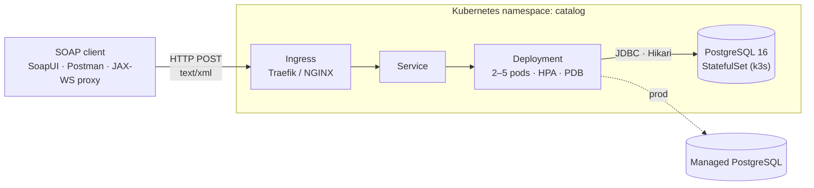
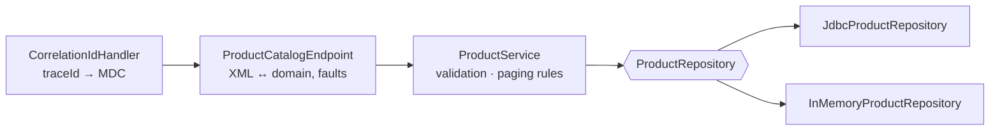
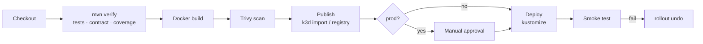

# Product Catalog – SOAP Web Service (JAX-WS)


-blue)


A production-style **SOAP web service** for a product catalog: CRUD, keyword search, filtering,
sorting and pagination. It's built on **Jakarta XML Web Services (JAX-WS 4 / Eclipse Metro)**, stores
data in **PostgreSQL**, ships as a **Docker** image and is deployed to **Kubernetes (k3s/k3d)** by a
**Jenkins** pipeline.

It was built as a learning project for a Spring REST course, as a SOAP baseline. The domain and service
layers have no SOAP dependencies, so the same catalog can later be exposed as REST without changing
them.

---

## Contents
- [Highlights](#highlights)
- [Architecture](#architecture)
- [API at a glance](#api-at-a-glance)
- [Quick start](#quick-start)
- [Testing](#testing)
- [Deployment](#deployment)
- [Configuration](#configuration)
- [Project layout](#project-layout)
- [Tech stack](#tech-stack)
- [Roadmap](#roadmap)

---

## Highlights

| Area | What you get |
|---|---|
| **API** | 6 operations, document/literal WSDL, versioned namespace (`/v1`) |
| **Search** | Keyword (name, SKU, description), category, price range, in-stock; sort by 5 fields; stable ordering |
| **Pagination** | 0-based pages, total counts, `hasNext`/`hasPrevious`; default 20, **capped at 100** |
| **Errors** | One typed fault: `code` + `message` + per-field `details` + `traceId`. No stack traces leak |
| **Observability** | `X-Correlation-Id` → `traceId` in faults, response header and every log line |
| **Persistence** | PostgreSQL + Flyway migrations; in-memory store for quick local runs |
| **Quality gates** | Unit + integration tests, Testcontainers PostgreSQL, **WSDL contract test**, JaCoCo gate |
| **Ops** | Health probes, graceful shutdown, non-root read-only container, HPA, PDB, NetworkPolicy |
| **Delivery** | Jenkins (configured as code): test → image → Trivy scan → deploy → smoke test → auto-rollback |

---

## Architecture



**Inside a pod**: each request passes through these layers:



| Layer | Package | Knows about SOAP? |
|---|---|---|
| SOAP adapter | `ws` | yes |
| Business rules | `service` | no |
| Storage | `repository` | no |
| Model | `domain` | no |

---

## API at a glance

Endpoint `POST /ws/v1/products` · WSDL `GET /ws/v1/products?wsdl` · namespace `http://catalog.infy.com/v1`

| Operation | Input | Returns | Fault codes | REST equivalent |
|---|---|---|---|---|
| `createProduct` | `product` | `product` | `VALIDATION_FAILED`, `DUPLICATE_SKU` | `POST /products` |
| `getProduct` | `id` | `product` | `PRODUCT_NOT_FOUND` | `GET /products/{id}` |
| `updateProduct` | `id`, `product` | `product` | `PRODUCT_NOT_FOUND`, `VALIDATION_FAILED`, `DUPLICATE_SKU` | `PUT /products/{id}` |
| `deleteProduct` | `id` | – | `PRODUCT_NOT_FOUND` | `DELETE /products/{id}` |
| `listProducts` | `page?`, `size?` | `result` (page) | `VALIDATION_FAILED` | `GET /products?page=&size=` |
| `searchProducts` | `criteria` | `result` (page) | `VALIDATION_FAILED` | `GET /products?keyword=&category=&…` |

<details>
<summary><b>Example: search request and response</b></summary>

```xml
<soapenv:Envelope xmlns:soapenv="http://schemas.xmlsoap.org/soap/envelope/"
                  xmlns:cat="http://catalog.infy.com/v1">
  <soapenv:Body>
    <cat:searchProducts>
      <criteria>
        <category>Electronics</category>
        <minPrice>1000</minPrice><maxPrice>9000</maxPrice>
        <inStockOnly>true</inStockOnly>
        <sortBy>PRICE</sortBy><sortOrder>DESC</sortOrder>
        <page>0</page><size>3</size>
      </criteria>
    </cat:searchProducts>
  </soapenv:Body>
</soapenv:Envelope>
```
```xml
<result>
  <items>
    <product><id>4</id><sku>ELEC-HEAD-01</sku><name>Noise Cancelling Headphones</name>…<price>8999.00</price>…</product>
    <product><id>7</id><sku>ELEC-SSD-01</sku>…<price>6499.00</price>…</product>
    <product><id>2</id><sku>ELEC-KEYB-01</sku>…<price>3499.00</price>…</product>
  </items>
  <page>0</page><size>3</size><totalElements>5</totalElements>
  <totalPages>2</totalPages><hasNext>true</hasNext><hasPrevious>false</hasPrevious>
</result>
```
</details>

<details>
<summary><b>Example: fault</b></summary>

Faults are HTTP 500 (per the SOAP spec). Clients branch on `code`:

```xml
<ns2:CatalogFault xmlns:ns2="http://catalog.infy.com/v1">
  <code>VALIDATION_FAILED</code>
  <message>Request validation failed</message>
  <details>
    <detail>name is required</detail>
    <detail>price must be &gt;= 0</detail>
  </details>
  <traceId>my-test-1</traceId>
</ns2:CatalogFault>
```
</details>

Ready-made envelopes for every operation and fault are in [`soap-samples/`](soap-samples).

---

## Quick start

**Prerequisites:** JDK 21, Maven 3.9+ (Docker optional).

```bash
# 1. Build and run with the in-memory store and 25 demo products
mvn -B -ntp clean package -DskipTests
STORE_TYPE=memory SEED_DATA=true java -jar target/product-catalog-ws.jar

# 2. In a second terminal: call it
./soap-samples/send.sh soap-samples/06-search-filter-sort-page.xml
./scripts/smoke-test.sh http://localhost:8080
```

<details>
<summary>Windows PowerShell</summary>

```powershell
$env:STORE_TYPE="memory"; $env:SEED_DATA="true"; java -jar target\product-catalog-ws.jar

Invoke-WebRequest -Uri http://localhost:8080/ws/v1/products -Method Post `
  -ContentType 'text/xml; charset=utf-8' -Headers @{ SOAPAction = '""' } `
  -InFile soap-samples\06-search-filter-sort-page.xml | Select-Object -ExpandProperty Content
```
Run the `.sh` scripts from Git Bash or WSL2.
</details>

**With PostgreSQL:** `docker compose up -d --build`

**GUI:** import `http://localhost:8080/ws/v1/products?wsdl` into **SoapUI** or **Postman**. Requests
for all operations are generated for you.

| URL | Purpose |
|---|---|
| http://localhost:8080/ws/v1/products?wsdl | WSDL |
| http://localhost:8080/health/live | Liveness |
| http://localhost:8080/health/ready | Readiness (checks the DB) |

---

## Testing

```bash
mvn -B -ntp clean verify
```

| Suite | Covers | Docker needed |
|---|---|---|
| Unit (`*Test`) | config, validation, search/sort/paging rules, in-memory repository | no |
| `ProductCatalogEndpointIT` | every operation over real HTTP via a JAX-WS proxy; faults, headers, paging | no |
| `JdbcProductRepositoryIT` | same repository contract on PostgreSQL 16 (Testcontainers) | yes, skipped without it |
| `WsdlContractIT` | published WSDL/XSD vs the committed baseline: catches breaking changes | no |

The first time, create the contract baseline: `./scripts/update-contract.sh`, then commit
`src/test/resources/contract/`.
Coverage report: `target/site/jacoco/index.html` (gate: 65 % lines).

---

## Deployment

| Target | Command | Details |
|---|---|---|
| Docker Compose | `docker compose up -d --build` | app + PostgreSQL |
| k3d (k3s in Docker, any OS) | `make k3d-up && make k3d-deploy` | Traefik ingress on `localhost:8081` |
| Native k3s (Linux/WSL2) | `./infra/k3s/install-k3s.sh && ./infra/k3s/deploy-local.sh` | |
| Jenkins (local lab) | `make jenkins-up` → http://localhost:8090 | job created via JCasC |
| Production | Jenkins `DEPLOY_ENV=prod` | manual approval, read-only smoke test |



Step-by-step instructions for every target: **[HOW_TO_RUN.md](HOW_TO_RUN.md)**.

---

## Configuration

Environment variables (a ConfigMap in Kubernetes). The most used ones:

| Variable | Default | Purpose |
|---|---|---|
| `STORE_TYPE` | `memory` | `memory` or `postgres` |
| `DB_URL` / `DB_USERNAME` / `DB_PASSWORD` | – | required for `postgres` |
| `SEED_DATA` | `false` | load 25 demo products |
| `PAGE_SIZE_DEFAULT` / `PAGE_SIZE_MAX` | `20` / `100` | paging defaults and cap |
| `APP_PORT` | `8080` | HTTP port |

Full list: [HOW_TO_RUN.md → Configuration reference](HOW_TO_RUN.md#configuration-reference).

---

## Project layout

```
src/main/java/com/infy/catalog/
├── ws/            SEI, endpoint, JAXB DTOs, faults, correlation-id handler
├── service/       business rules, validation, paging policy
├── repository/    in-memory + JDBC (PostgreSQL) implementations
├── domain/        records and domain exceptions
├── infra/         health probes, Hikari, Flyway, Metro settings
├── config/        typed env-var configuration
├── client/        JAX-WS proxy client + demo
└── Application    composition root, HTTP server, graceful shutdown
src/main/resources/db/      Flyway migrations (schema) and seed data
k8s/base/{app,postgres}     Kustomize bases
k8s/overlays/{k3s,prod}     environment overlays
infra/{k3d,k3s,jenkins}     cluster and CI setup
soap-samples/               ready-made SOAP envelopes + send.sh
scripts/                    smoke test, contract baseline
Dockerfile · docker-compose.yml · Jenkinsfile · Makefile
```

Contributing or using Claude Code? Read **[CLAUDE.md](CLAUDE.md)**: layering rules, how to evolve
the WSDL safely, error and logging conventions.

---

## Tech stack

| Layer | Technology |
|---|---|
| Language / runtime | Java 21, JDK built-in HTTP server |
| SOAP | Jakarta XML Web Services 4 (Eclipse Metro), JAXB 4 |
| Data | PostgreSQL 16, HikariCP, Flyway |
| Logging | SLF4J, Logback (JUL bridged) |
| Testing | JUnit 5, Testcontainers, JaCoCo |
| Packaging | Docker (multi-stage, Temurin JRE Alpine) |
| Kubernetes | Kustomize, k3s / k3d, Traefik, HPA, PDB, NetworkPolicy, Pod Security `restricted` |
| CI/CD | Jenkins (Configuration as Code, Job DSL), Trivy |

---

## Roadmap

- [ ] Authentication: WS-Security UsernameToken or mTLS at the ingress
- [ ] Metrics: Micrometer + Prometheus endpoint
- [ ] Faster keyword search: `pg_trgm` GIN index
- [ ] REST version of the same catalog with Spring Boot (reusing `service`, `repository`, `domain`)
